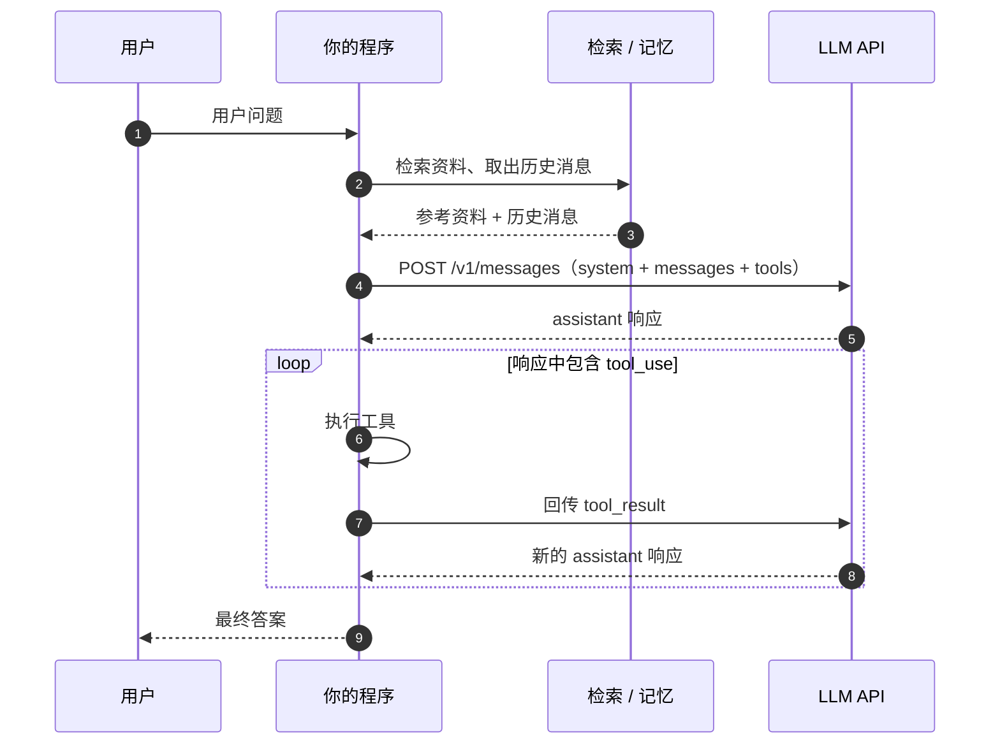

# Building Block：Augmented LLM

> 这是《Building Effective Agents》精读系列第 2 篇。原文：<https://www.anthropic.com/research/building-effective-agents>
>
> 上一篇：[什么是 Agent，什么不是？](01-what-is-an-agent.md)

## 先说结论

Anthropic 把 **Augmented LLM** 称为 agentic system 的基础积木：一个在 LLM 之外接上了**检索**（retrieval）、**工具**（tools）和**记忆**（memory）的模型。

它不是某种框架，也不是一个必须导入的包。落到代码里，它就是一次普通的模型调用，只是在调用前后多了几件事：

- 调用前，把检索到的资料放进提示词；
- 调用时，把工具 schema 一起发给模型；
- 调用后，把历史消息和工具结果保存下来，下一轮再带上。

Workflow 和 Agent 都是在这个积木上搭起来的。区别只在于：**接下来做什么，是代码决定，还是模型决定。**

## 为什么需要增强

单独一个 LLM 有三个硬限制：

| 限制 | 表现 | 增强方式 |
| --- | --- | --- |
| 不知道私有数据 | 回答不了公司内部文档、用户订单、最新库存 | 检索 |
| 不能执行动作 | 只能生成文本，不能查库、发邮件、跑代码 | 工具 |
| 不记得上一轮 | API 本身无状态，每次请求都要重新带上上下文 | 记忆 |

这三件事都不是“让模型更聪明”，而是**给模型补上它缺少的信息和行动能力**。模型仍然是那个模型，改变的是你交给它的上下文，以及你能从它那里拿回什么。

## 三种增强分别发生在哪

先看一张时序图。三种增强介入的位置并不一样：



- **检索**发生在请求之前，属于输入侧；
- **工具**由模型在响应里提出调用请求，真正执行的是你的代码；
- **记忆**横跨多次请求，靠你自己维护消息列表或外部存储。

## 检索：把资料放进提示词

检索增强的核心不是“接一个向量库”，而是**在正确的时候，把正确的资料放进上下文**。最小实现可以简单到先查一次数据库，再把结果拼进提示词：

```go
type Document struct {
	Title string
	Text  string
}

// retrieve 是占位：真实系统里可能是向量检索、BM25、搜索服务或内部知识库。
func retrieve(ctx context.Context, question string) ([]Document, error) {
	return searchClient.Search(ctx, question, 5)
}

func buildContext(docs []Document) string {
	var b strings.Builder
	for _, doc := range docs {
		fmt.Fprintf(&b, "### %s\n%s\n\n", doc.Title, doc.Text)
	}
	return b.String()
}
```

然后在调用模型时，把资料和问题一起交给它：

```go
docs, err := retrieve(ctx, question)
if err != nil {
	log.Fatal(err)
}

system := `你是一名客服助手。
只根据“参考资料”回答问题；资料不足时直接说明，不要编造。
回答末尾列出你引用的资料标题。`

userText := fmt.Sprintf("参考资料：\n%s\n问题：%s", buildContext(docs), question)

resp, err := client.Messages.New(ctx, anthropic.MessageNewParams{
	Model:     model,
	MaxTokens: 1024,
	System:    []anthropic.TextBlockParam{{Text: system}},
	Messages: []anthropic.MessageParam{
		anthropic.NewUserMessage(anthropic.NewTextBlock(userText)),
	},
})
```

这里有几个容易忽略的点：

- **检索质量决定上限。** 提示词写得再好，也救不回没检索到的资料。切分粒度、索引方式、是否重排，都比“再让模型想想”更重要。
- **允许模型说“不知道”。** 如果不给退出路径，模型就会用训练数据里的常识填补空白，看起来像在回答，实际上在编。
- **把来源一起交给模型。** 标题、URL、更新时间都可以放进上下文，方便模型引用，也方便你排查。
- **不要把所有文档都塞进去。** 上下文有成本，也有注意力上限。宁可选得少而准，不要多而杂。

## 工具：让模型能行动

工具的本质是**一份双方都遵守的接口约定**：你告诉模型有哪些工具、每个工具接受什么参数；模型决定是否调用、传什么参数；你的代码负责真正执行，并把结果交回去。

Anthropic Messages API 里的工具定义长这样：

```go
tools := []anthropic.ToolUnionParam{
	{
		OfTool: &anthropic.ToolParam{
			Name:        "search_orders",
			Description: anthropic.String("按用户 ID 查询订单列表。用户询问订单状态、物流或退款进度时使用。"),
			InputSchema: anthropic.ToolInputSchemaParam{
				Properties: map[string]any{
					"user_id": map[string]any{
						"type":        "string",
						"description": "用户 ID，例如 u_123",
					},
					"status": map[string]any{
						"type":        "string",
						"enum":        []string{"paid", "shipped", "refunded"},
						"description": "可选，按订单状态过滤",
					},
				},
				Required: []string{"user_id"},
			},
		},
	},
}
```

OpenAI Chat Completions 的字段名不同，结构是一样的：

```go
tools := []openai.ChatCompletionToolUnionParam{
	openai.ChatCompletionFunctionTool(shared.FunctionDefinitionParam{
		Name:        "search_orders",
		Description: openai.String("按用户 ID 查询订单列表。用户询问订单状态、物流或退款进度时使用。"),
		Parameters: shared.FunctionParameters(map[string]any{
			"type": "object",
			"properties": map[string]any{
				"user_id": map[string]any{
					"type":        "string",
					"description": "用户 ID，例如 u_123",
				},
			},
			"required": []string{"user_id"},
		}),
	}),
}
```

几个实践建议：

- **描述写“什么时候用”，而不只是“是什么”。** 模型靠描述做选择。写清楚适用场景和边界，比写一堆实现细节更有用。
- **参数用 schema 收紧。** 能用 `enum` 就不要让模型自由发挥；能给示例就给示例。Anthropic 把这叫“poka-yoke”，让错误更难发生。
- **工具结果也是不可信输入。** 网页、邮件、用户上传的文档都可能包含指令。不要把工具返回的内容当成系统指令。
- **错误要能回到模型。** 参数解析失败、查无数据、权限不足，都应该作为工具结果返回，让模型有机会修正或向用户解释。直接 panic 会让整个循环中断。

完整的“模型要工具 → 程序执行 → 结果回传 → 模型继续”的往返，在[第 1 篇](01-what-is-an-agent.md#先看一次真实的-http-往返)里已经用 curl 走过一遍。这里的重点是：**工具定义只是增强，执行循环才是 Agent。**

## 记忆：把历史带回来

LLM API 是无状态的。模型不会记得你上一次说了什么，所谓“记忆”是调用方在每次请求里重新带上的上下文。

最小版本就是维护一个消息切片：

```go
messages := []anthropic.MessageParam{
	anthropic.NewUserMessage(anthropic.NewTextBlock("我想改一下收货地址")),
}

// 第一轮
resp, err := client.Messages.New(ctx, anthropic.MessageNewParams{
	Model:     model,
	MaxTokens: 1024,
	Messages:  messages,
})
if err != nil {
	log.Fatal(err)
}

// 把 assistant 的完整响应加入历史，再追加新的用户消息
messages = append(messages, resp.ToParam())
messages = append(messages,
	anthropic.NewUserMessage(anthropic.NewTextBlock("改成杭州市西湖区文三路 100 号")))
```

这样第二轮请求就同时包含了两条用户消息和上一轮 assistant 的回答，模型才能理解“改成”是在改什么。

但“把所有历史都带上”很快就会遇到问题：

- **长度有限。** 对话越长，成本和延迟越高，最终会超过上下文窗口。
- **噪声累积。** 很早以前的寒暄和跑题内容会稀释当前任务的关键信息。
- **隐私和合规。** 历史里可能包含不该长期保存的个人信息。

常见做法是分层：

| 记忆类型 | 存什么 | 放在哪 |
| --- | --- | --- |
| 短期上下文 | 最近几轮对话、当前任务状态 | 消息列表，直接随请求发送 |
| 摘要记忆 | 更早对话的压缩摘要 | 消息列表中的一条 system/user 消息 |
| 长期记忆 | 用户偏好、事实、文档 | 数据库或向量库，按需检索回上下文 |

无论用哪种，原则都一样：**只带当前任务需要的信息。** 记忆不是仓库，上下文不是越长越好。

## 合起来：一次增强后的调用

把三种增强放进同一个函数，结构就很清楚了：

```go
func answer(
	ctx context.Context,
	client anthropic.Client,
	model anthropic.Model,
	question string,
	history []anthropic.MessageParam,
) (string, error) {
	// 1. 检索：只取和当前问题相关的资料
	docs, err := retrieve(ctx, question)
	if err != nil {
		return "", err
	}

	// 2. 记忆：复制历史，避免 append 改到调用方的底层数组
	messages := make([]anthropic.MessageParam, 0, len(history)+1)
	messages = append(messages, history...)

	userText := fmt.Sprintf(
		"参考资料：\n%s\n问题：%s",
		buildContext(docs), question,
	)
	messages = append(messages, anthropic.NewUserMessage(anthropic.NewTextBlock(userText)))

	// 3. 工具：把 schema 一并交给模型
	resp, err := client.Messages.New(ctx, anthropic.MessageNewParams{
		Model:     model,
		MaxTokens: 1024,
		System: []anthropic.TextBlockParam{{
			Text: "只根据参考资料回答；资料不足时明确说明。需要查询订单时调用工具。",
		}},
		Messages: messages,
		Tools:    tools,
	})
	if err != nil {
		return "", err
	}

	// 如果 resp 里有 tool_use，这里需要执行工具并再请求一次；
	// 是否继续循环、循环几次，取决于外层是 Workflow 还是 Agent。
	return textOf(resp), nil
}
```

注意最后那段注释：**这个函数只负责一次增强后的调用，不负责决定要不要继续。** 控制循环的代码放在哪里，决定了整个系统的架构类型。

## 增强不等于 Agent

这是最容易混淆的地方。下面三种系统都用了 Augmented LLM，但架构完全不同：

| 系统 | 检索 | 工具 | 谁决定下一步 |
| --- | --- | --- | --- |
| 固定 RAG 问答 | 每次请求前查一次 | 不调用 | 代码 |
| 带工具的客服 workflow | 按分支决定是否查 | 代码决定调用哪个 | 代码 |
| 自主 Agent | 模型按需请求 | 模型决定调用哪个、调几次 | 模型 |

“定义了 tools”不等于 Agent。只要模型返回 `tool_use` 之后，是你的代码按固定规则执行、按固定路径继续，那它仍然是 Workflow。

反过来，Agent 也不是“更高级的 Augmented LLM”。它只是把这个积木放进了循环，并把循环的控制权交给了模型。能力和风险是一起放大的。

## 设计要点

原文在讲增强时，特别强调两件事：**针对具体场景定制能力**，以及**给模型一个易用、文档清晰的接口**。落到工程上：

1. **先问需不需要增强。** 如果一次提示词就能解决，不要为了“架构完整”硬加检索和工具。
2. **接口要窄。** 一个工具只做一件事，参数少而明确，比一个大而全的 `do_everything` 好用得多。
3. **给模型思考空间。** 工具描述、参数说明、示例都可以多写几句。省下的 token 往往会以错误调用的形式还回来。
4. **结果要可验证。** 检索结果带来源，工具返回结构化数据，代码里做确定性检查。不要只靠模型“看起来答对了”。
5. **集成方式尽量标准。** Anthropic 在原文中提到 MCP（Model Context Protocol）作为连接工具和数据源的一种方式。它的价值在于把“怎么接”从每个应用里抽出来，但协议本身不改变系统的架构分类。

## 本文小结

- **Augmented LLM** 是基础积木：LLM + 检索 + 工具 + 记忆。
- 检索发生在请求前，工具由模型提出、代码执行，记忆是调用方维护的跨请求上下文。
- 增强只是给模型补信息和行动能力，**不自动等于 Agent**。
- 判断架构仍然看控制流：下一步由代码决定是 Workflow，由模型决定才是 Agent。
- 先把接口设计好、把结果验证好，再考虑要不要把循环交给模型。

下一篇从单个积木上升到组合方式：**Workflow 总览**，看看五种模式分别在什么场景下值得引入。

---

- 系列目录：[README.md](README.md)
- 上一篇：[什么是 Agent，什么不是？](01-what-is-an-agent.md)
- 下一篇：[Workflow 总览：什么时候需要 workflow](03-workflow-overview.md)
